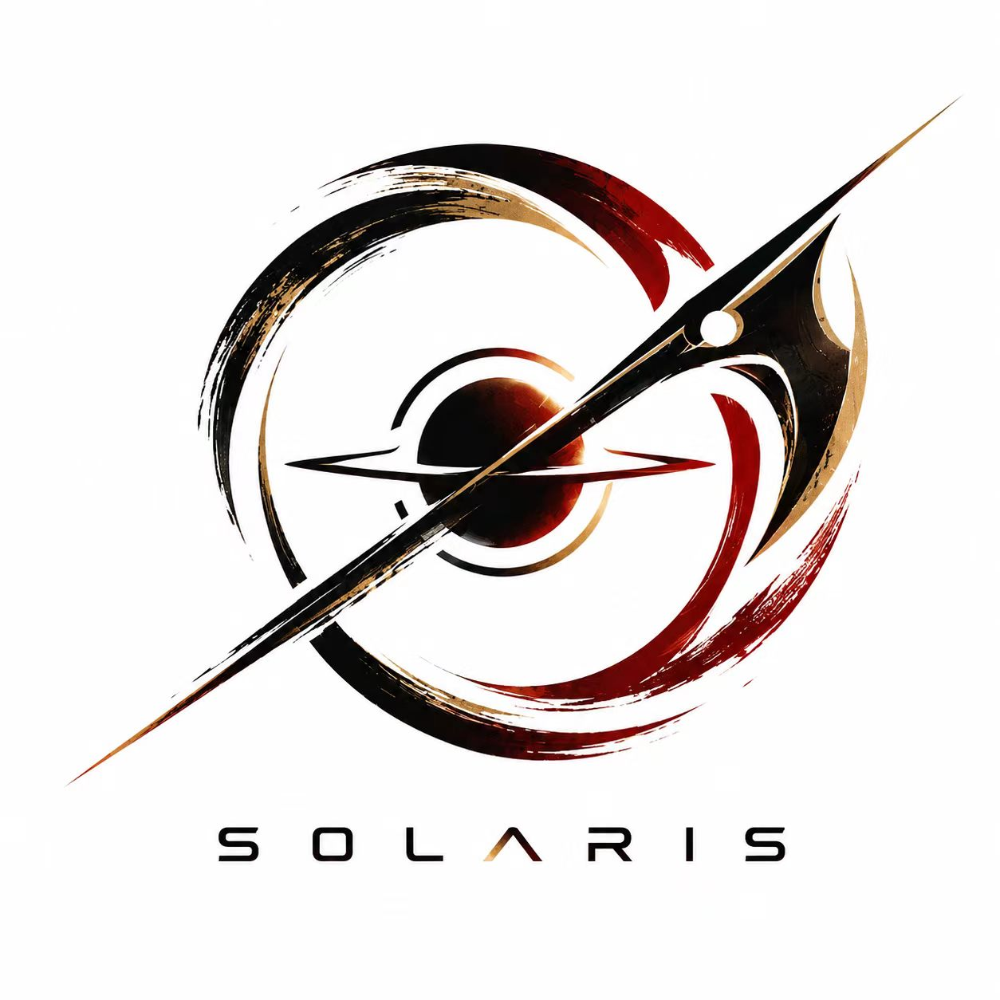

# 天钺 SOLARIS

**东南大学成贤学院（SEU-CXXY）RoboMaster 机甲大师战队**

*以太阳为名，以钺为志 —— 秣陵行胜，共赴千山。*

 

---

## 🌞 关于我们

| | |
| --- | --- |
| **中文名** | 天钺 |
| **英文名** | Solaris（源自古拉丁语「太阳」） |
| **学院** | 东南大学成贤学院（Southeast University Chengxian College） |
| **所在地** | 江苏 · 南京 |
| **口号** | 秣陵行胜，共赴千山 |

我们从南京出发，以太阳为名、以「钺」为志，把机械、嵌入式、视觉、算法和运营拧成一股绳——在赛场上自研机器人，在弹丸与装甲之间寻找工程的答案。

## ⚔️ 赛事与技术方向

| 方向 | 内容 |
| --- | --- |
| 🏆 **赛事体系** | RoboMaster 超级对抗赛（RMUC）· 高校联盟赛（RMUL）· 技术挑战赛（RMUT） |
| ⚙️ **机械** | 底盘、云台、发射机构、供弹链路的结构设计与仿真 |
| 🔌 **电控 / 嵌入式** | STM32、电机驱动、CAN 通信、功率与状态管理 |
| 👁️ **视觉 / 算法** | 相机标定、目标检测、自瞄、弹道解算、决策与路径规划 |
| 📣 **运营 / 宣发** | 品牌视觉、赛事记录、社区运营与开源维护 |

## 🚀 战队开源项目

| 项目 | 说明 |
| --- | --- |
| 🏠 [**solaris-rm**](https://github.com/SEU-CX-RM-Solaris/solaris-rm) | 战队官网：战队介绍、动态与赛季目标 |
| 📝 [**solaris-blog-rm-seu-cxxy**](https://github.com/SEU-CX-RM-Solaris/solaris-blog-rm-seu-cxxy) | 技术博客：步兵自瞄拆解、STM32 入门与招新培训笔记 |
| 📚 [**rm-open-source-leaderboard**](https://github.com/SEU-CX-RM-Solaris/rm-open-source-leaderboard) | RM 开源资源目录：战队 / 个人 / 官方 / 第三方代码与图纸 |
| 🖥️ [**solaris-fetch**](https://github.com/SEU-CX-RM-Solaris/solaris-fetch) | 终端横幅：打开终端就能看到 SOLARIS 的太阳 |
| 🎯 [**simple_aim**](https://atomgit.com/seu-cx-solaris/simple_aim) `AtomGit` | 最小自瞄教学项目：读视频 → 找灯条 → 配对装甲板 → PnP 测距 |

> 🧩 **成员的其他开源**：[成贤校园网助手](https://atomgit.com/DanielMaster/cxxy-campus-wifi) · [校园系统自动化工具](https://atomgit.com/DanielMaster/seu-cxxy-campus-skill)

## 🏁 2027 赛季

- 🎯 **首站赛事**：[RMUL 高校联盟赛 · 步兵 1v1](https://www.robomaster.com/zh-CN/robo/college-league)
- 🔧 **机械基线**：沈阳理工大学 Ambition 战队开源全向轮中供步兵方案 + 适配二次开发
- 📖 **参考**：[规则 / 资料中心](https://bbs.robomaster.com/wiki/20204847) · [赛事公告](https://www.robomaster.com/zh-CN/resource/announcement/competition)

## 🤝 加入我们

长期招募对机器人工程感兴趣的同学：

`机械结构` · `电控 / 嵌入式` · `视觉算法` · `运营宣发`

不要求你一开始就会，但希望你愿意动手、愿意把想法做成能跑的东西。

**招新 QQ 群：`1103192008`** ｜ 也可以在任意组织仓库提 Issue。

## 🙏 致谢

感谢 DJI 大疆创新与 RoboMaster 提供赛事与平台；感谢沈阳理工大学 **Ambition** 战队等先行者的开源方案，让后来者少走弯路；感谢所有把代码、图纸与经验公开出来的战队与个人——开源让我们共同进步。

---

**天钺 SOLARIS** · 东南大学成贤学院 RoboMaster 战队

秣陵行胜，共赴千山

